  

## 🔭 `ls ~/projects`

  
  

  
  

## 💻 `pacman -Q`

  

### 🦀 Currently compiling

  

## 📊 `uptime`

  <a href="https://github.com/IgorD-lab?tab=overview">
    <picture>
      <source media="(prefers-color-scheme: dark)" srcset="https://streak-stats.demolab.com?user=IgorD-lab&theme=radical&hide_border=true&background=0d1117">
      <source media="(prefers-color-scheme: light)" srcset="https://streak-stats.demolab.com?user=IgorD-lab&theme=default&hide_border=true">
      
    </picture>
  </a>
  &nbsp;
  

## 📫 `ping igor`

  &nbsp;
  &nbsp;
  

